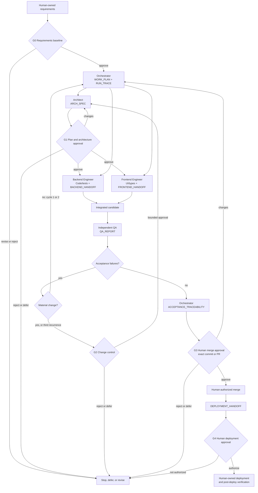

# One-Page Multi-Agent Workflow

The agents are development-time collaborators; no agent runs in the Laravel application's request path. Detailed rules are in `WORKFLOW_DESIGN.md`.

## Control legend

- Backend and frontend may run in parallel only after G1 and against the same approved contract.
- Every arrow between roles carries a persistent repository artifact; conversation only announces or summarizes it.
- Each artifact has one writer. Canonical names and owners are defined in `artifacts/README.md`.
- QA independently verifies every changed acceptance criterion. A repeated underlying failure is limited to two remediation cycles before human escalation.
- Agents checkpoint under `artifacts/checkpoints/<run-id>/` before pause, interruption, reassignment, or context compaction.
- The Orchestrator alone writes `RUN_TRACE.json`, including activity, decisions, elapsed time, usage/cost availability, errors, and retries.
- G3 authorizes only the identified merge. G4 separately authorizes deployment.
