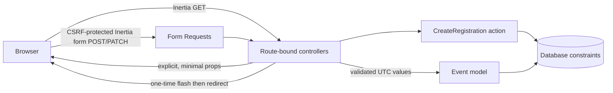

# Events Vertical Slice Architecture Specification

Run ID: `events-vslice-20261023-001`

Role: Solutions Architect

Status: `READY`

Repository commit or working-tree identifier: `39037c4577cd78abe2df0fd5a5cafe7ae0589750` plus uncommitted planning artifacts for this run

Acceptance criteria: `EVT-001`–`EVT-004`, `REG-001`–`REG-006`, `ADM-001`–`ADM-005`, `QUA-001`–`QUA-003`

Input artifacts: `EVENT_SPEC.md`, `AGENTS.md`, `HUMAN_GATES_AND_GUARDRAILS.md`, `WORKFLOW_DESIGN.md`, `WORKFLOW_DIAGRAM.md`, `artifacts/README.md`, `.agents/architect.md`, `artifacts/WORK_PLAN.md`

Output artifacts: `artifacts/ARCH_SPEC.md`, `artifacts/checkpoints/events-vslice-20261023-001/architect.md`

## Scope and design posture

This design implements only the approved public event discovery, attendee registration, and deliberately unauthenticated administration slice. It uses the installed Laravel `13.38.0`, Inertia Laravel `3.5.2`, Inertia React `^3.0.0`, React `^19.2.0`, Wayfinder `0.1.23`, Tailwind CSS `^4.0.0`, and Pest `5.3.3` stack. It adds no dependency, API, authentication layer, notification, deletion flow, capacity logic, pagination, or deployment behavior.

The design follows the repository's existing controller, typed Form Request, Eloquent factory, `Inertia::render`, `Inertia::flash`, React `<Form>`, generated Wayfinder, Radix-based component, and Pest feature-test patterns. A focused `CreateRegistration` action uses the existing `app/Actions` structure because the database-race conversion is a discrete invariant that must be deterministic and independently testable; no service or repository layer is introduced.

G0 permits architecture only. `READY` means this artifact is complete for Orchestrator review; it does not approve G1 or authorize implementation.

## Runtime and data flow



- All routes use Laravel's `web` middleware. No admin route uses `auth` or `verified`; state-changing routes retain CSRF protection.
- Implicit route-model binding supplies `Event $event`; unknown identifiers use Laravel's normal 404 response.
- Controllers map models to explicit arrays. They never pass an unbounded Event or Registration model to Inertia.
- Public queries never load registrations. Only the admin registrant endpoint selects registration email addresses.

## Persistence contract

### `events`

| Column                     | Database definition                        | Application contract                                                             |
| -------------------------- | ------------------------------------------ | -------------------------------------------------------------------------------- |
| `id`                       | database-generated big integer primary key | Public route-model key and deterministic ordering tie-breaker.                   |
| `title`                    | `varchar(255)`, not null                   | Trimmed, required.                                                               |
| `description`              | `text`, not null                           | Trimmed, required, rendered as plain text.                                       |
| `location`                 | `varchar(255)`, not null                   | Trimmed, required.                                                               |
| `starts_at`                | `datetime`, not null                       | Offset-free database value representing UTC.                                     |
| `ends_at`                  | `datetime`, not null                       | Offset-free database value representing UTC and strictly later than `starts_at`. |
| `created_at`, `updated_at` | framework timestamps                       | Framework-managed.                                                               |

Indexes:

- Primary key on `id`.
- Composite index `events_starts_at_id_index` on (`starts_at`, `id`) for the required public/admin chronological order.

The `Event` model uses `HasFactory`, precise `hasMany(Registration::class)` typing, and only the five writable domain attributes. Its `startsAt()` and `endsAt()` attribute accessors/mutators centralize the UTC invariant: raw database values are parsed explicitly as UTC into `CarbonImmutable`, and assigned date-time values are converted to UTC and formatted with the model's database date format. This avoids interpreting UTC database values in a non-UTC PHP default timezone.

### `registrations`

| Column                     | Database definition                         | Application contract                                      |
| -------------------------- | ------------------------------------------- | --------------------------------------------------------- |
| `id`                       | database-generated big integer primary key  | Deterministic ordering tie-breaker.                       |
| `event_id`                 | unsigned big integer, not null, foreign key | References `events.id`; required relationship.            |
| `name`                     | `varchar(255)`, not null                    | Trimmed attendee name.                                    |
| `email`                    | `varchar(255)`, not null                    | Trimmed and lowercased before validation and persistence. |
| `created_at`, `updated_at` | framework timestamps                        | `created_at` is the displayed registration time.          |

Constraints and indexes:

- Named composite unique index `registrations_event_id_email_unique` on (`event_id`, `email`). The same normalized email may occur for different events.
- Composite index `registrations_event_id_created_at_id_index` on (`event_id`, `created_at`, `id`) for deterministic registrant ordering.
- Foreign key `event_id -> events.id` uses `RESTRICT` / `NO ACTION` on delete. There is no deletion route. This fails safely instead of silently destroying registrations if a future code path attempts deletion; changing this policy requires G2 and a data-retention plan.

The `Registration` model uses `HasFactory`, a precisely typed `belongsTo(Event::class)` relationship, and only `event_id`, `name`, and `email` as writable attributes. `email` is hidden from default model array/JSON serialization; the admin controller deliberately maps it into the registrant-only prop.

Migrations create `events` before `registrations` and roll back `registrations` before `events`. Fresh-run `down()` methods may drop these newly introduced tables; after real data exists, rollback is destructive and requires G2, a backup, and explicit human authorization rather than an automatic production rollback.

Factories are required for both models and produce only synthetic data. No dedicated event/registration seeder is needed for this slice.

## HTTP, controller, and Wayfinder contract

| Method and URI                            | Route name                         | Controller action                                              | Inertia/redirect behavior                                                                                                         |
| ----------------------------------------- | ---------------------------------- | -------------------------------------------------------------- | --------------------------------------------------------------------------------------------------------------------------------- |
| `GET /`                                   | `home`                             | `App\Http\Controllers\EventController@index`                   | `events/index`; replaces the starter welcome page while preserving the existing `home` contract.                                  |
| `GET /events/{event}`                     | `events.show`                      | `App\Http\Controllers\EventController@show`                    | `events/show`; implicit binding gives normal 404.                                                                                 |
| `POST /events/{event}/registrations`      | `events.registrations.store`       | `App\Http\Controllers\EventRegistrationController@store`       | On success flashes confirmation and redirects to `events.show`; on validation/duplicate failure redirects back with field errors. |
| `GET /admin/events`                       | `admin.events.index`               | `App\Http\Controllers\Admin\EventController@index`             | `admin/events/index`.                                                                                                             |
| `GET /admin/events/create`                | `admin.events.create`              | `App\Http\Controllers\Admin\EventController@create`            | `admin/events/create`.                                                                                                            |
| `POST /admin/events`                      | `admin.events.store`               | `App\Http\Controllers\Admin\EventController@store`             | Creates, flashes success toast, redirects to `admin.events.edit`.                                                                 |
| `GET /admin/events/{event}/edit`          | `admin.events.edit`                | `App\Http\Controllers\Admin\EventController@edit`              | `admin/events/edit`.                                                                                                              |
| `PATCH /admin/events/{event}`             | `admin.events.update`              | `App\Http\Controllers\Admin\EventController@update`            | Updates only event fields, flashes success toast, redirects to `admin.events.edit`.                                               |
| `GET /admin/events/{event}/registrations` | `admin.events.registrations.index` | `App\Http\Controllers\Admin\EventRegistrationController@index` | `admin/events/registrations`; registrations ordered by `created_at`, then `id`.                                                   |

Routes are explicit because the exposed resource subset is small and there is intentionally no event `destroy` or public API action. Admin routes sit outside authentication middleware. Static `/create` routes must be declared before routes containing `{event}`.

Wayfinder remains generated by the installed Vite plugin with form variants enabled. React navigation imports named routes from `@/routes`; forms import controller actions from `@/actions` and spread `.form()` output into Inertia `<Form>`. No URL or HTTP method is duplicated in hand-authored TypeScript. Backend owns route/controller definitions and generated `resources/js/actions/**`, `resources/js/routes/**`, and `resources/js/wayfinder/**`; frontend waits for those generated contracts before final integration.

## Validation and normalization

### Event requests

One `App\Http\Requests\Admin\SaveEventRequest` is used by both create and update because the allowed fields and rules are identical. `prepareForValidation()` trims `title`, `description`, and `location` without collapsing meaningful internal whitespace.

| Field         | Rules                                                                  |
| ------------- | ---------------------------------------------------------------------- |
| `title`       | `required`, `string`, `max:255`                                        |
| `description` | `required`, `string`                                                   |
| `location`    | `required`, `string`, `max:255`                                        |
| `starts_at`   | `required`, exact `date_format:Y-m-d\TH:i`                             |
| `ends_at`     | `required`, exact `date_format:Y-m-d\TH:i`, strictly `after:starts_at` |

After validation, the controller parses both `datetime-local` values in `config('app.timezone')`, verifies the exact local format, converts them to UTC, and passes only the validated fields to `Event::create()` or `update()`. The configured timezone is supplied to every relevant page and shown visibly. The current configured timezone is `UTC`.

### Registration request

`App\Http\Requests\StoreRegistrationRequest::prepareForValidation()` trims `name`, and trims then lowercases `email` with Laravel's multibyte-aware string utility. Rules are:

- `name`: `required`, `string`, `max:255`.
- `email`: `required`, `string`, `email`, `max:255`, plus a unique rule scoped to the route-bound event's ID.

The scoped unique rule produces a friendly normal duplicate error, but it is not the concurrency control. The request never accepts an `event_id`; association always comes from the bound route model.

### Concurrent duplicate handling

`App\Actions\CreateRegistration` performs the single relationship insert. No pre-insert lock or transaction is needed for one atomic insert.

1. The request normalizes and checks the scoped application-level unique rule.
2. The action inserts through `$event->registrations()`.
3. The database composite unique index is authoritative when submissions race.
4. The action catches Laravel 13's `UniqueConstraintViolationException` only when its parsed index equals `registrations_event_id_email_unique` or its parsed columns equal `['event_id', 'email']` (driver-dependent metadata).
5. That expected conflict becomes a `ValidationException` error on `email`: “This email is already registered for this event.” The existing row is unchanged.
6. Any different constraint/database exception is rethrown; it is never mislabeled as a duplicate.

This action is tested directly after inserting a competing row, which deterministically exercises the exception-to-validation conversion without pretending SQLite requests are truly parallel. A separate feature test covers the ordinary duplicate response, and schema inspection/direct insertion proves the database invariant.

## Inertia page and prop contract

All date-time wire values named `*At` are UTC ISO-8601 strings with a `Z` suffix. The browser formats them with `Intl.DateTimeFormat` using the supplied IANA `timezone` option, never the browser's implicit timezone. Every time presentation includes a visible timezone label. Event description is rendered as escaped React text with preserved line breaks, never as raw HTML.

```ts
type EventSummary = {
    id: number;
    title: string;
    startsAt: string;
    endsAt: string;
    location: string;
};

type EventDetail = EventSummary & {
    description: string;
};

type EventEditData = EventDetail & {
    startsAtLocal: string; // Y-m-dTHH:mm in app timezone
    endsAtLocal: string; // Y-m-dTHH:mm in app timezone
};

type AdminRegistration = {
    id: number;
    name: string;
    email: string;
    registeredAt: string;
};

type RegistrationConfirmation = {
    eventTitle: string;
    attendeeName: string;
};
```

| Page                         | Exact page props                               |
| ---------------------------- | ---------------------------------------------- |
| `events/index`               | `{ events: EventSummary[]; timezone: string }` |
| `events/show`                | `{ event: EventDetail; timezone: string }`     |
| `admin/events/index`         | `{ events: EventSummary[]; timezone: string }` |
| `admin/events/create`        | `{ timezone: string }`                         |
| `admin/events/edit`          | `{ event: EventEditData; timezone: string }`   |
| `admin/events/registrations` | `{ event: Pick<EventSummary, 'id'              | 'title'>; registrations: AdminRegistration[]; timezone: string }` |

`events/index` and the admin event list order every event by ascending `starts_at`, then ascending `id`. No pagination or filter prop exists. Empty arrays drive explicit event and registrant empty states.

The Inertia flash type is augmented with:

```ts
type EventsFlashData = {
    toast?: FlashToast;
    registrationConfirmation?: RegistrationConfirmation;
};
```

Successful registration calls `Inertia::flash('registrationConfirmation', { eventTitle, attendeeName })` and redirects to `events.show`. The page renders that one-time flash in a visible `role="status"` / `aria-live="polite"` confirmation. Inertia v3 excludes flash data from browser history state, so refresh performs only the GET and cannot create a second row. Email is not included in flash or the URL.

Create/update use the existing `toast` flash convention. Server validation errors remain field-keyed (`title`, `description`, `location`, `starts_at`, `ends_at`, `name`, `email`), and Inertia preserves the submitted form state on validation redirects. Inputs connect labels and errors with `htmlFor`, `aria-invalid`, and `aria-describedby`; required fields use the HTML `required` affordance; submit buttons disable and communicate while processing.

The existing authenticated `AppLayout` cannot safely host guest pages because it assumes a user. A lightweight `EventsLayout` under the existing `resources/js/layouts` directory provides public/admin navigation using Wayfinder and is selected for `events/**` and `admin/events/**` in the existing Inertia layout resolver. The admin area visibly states that it is an unauthenticated proof-of-concept area; it must not imply security.

## Privacy and security boundaries

- Registration email is personal data. It appears only in the attendee's own form state and the deliberately unauthenticated admin registrant prop. It is excluded from public event props, URLs, flash data, model default serialization, logs, analytics, and committed fixtures.
- Controllers and the action must not log request payloads, validated registration arrays, registrations, or caught duplicate exceptions.
- Add `mask_bindings_in_exception_messages => true` to every configured SQL connection in `config/database.php`. This prevents an unexpected database exception from embedding an email query binding in its log message. G1 approval must explicitly include this small cross-cutting configuration change and the Backend assignment must name that path.
- React renders all user-supplied strings as text. No `dangerouslySetInnerHTML` is used.
- State-changing forms stay under `web` middleware for CSRF. No application authentication or authorization is added because that would contradict scope.
- Anyone who discovers `/admin/events` can create/edit events and view registrant names and emails. This is an intentional POC risk, not a secure admin design. G1 must accept the residual risk; G4 must separately accept exposure or require human-owned infrastructure restriction before any shared/internet deployment.

## Backend/frontend ownership seam and safe parallelism

| Backend-owned contract                                                                                                                | Frontend-owned use                                                                                                                     |
| ------------------------------------------------------------------------------------------------------------------------------------- | -------------------------------------------------------------------------------------------------------------------------------------- |
| Migrations, constraints, models, factories, action, Form Requests, controllers, routes, explicit prop mapping, and focused PHP tests. | Six Inertia pages, `EventsLayout`, feature-specific TypeScript types/components, field/error states, responsive and keyboard behavior. |
| Generated Wayfinder directories after route/controller changes.                                                                       | Imports generated names; never writes generated files or hard-codes route contracts.                                                   |
| Prop keys, ISO/local date formats, flash keys, validation error keys, ordering.                                                       | Treats this artifact's shapes as fixed; any change routes through Orchestrator and may trigger G2.                                     |

After G1, frontend may build page shells and types against these shapes while backend implements persistence/HTTP behavior. Final form and link integration waits for regenerated Wayfinder output. Neither role changes a route, prop, validation, timezone, privacy, or schema contract without Orchestrator reconciliation.

## Verification strategy

Focused Pest feature coverage must include:

- Event list ordering including equal-start `id` tie-breaker, required props, visible data, and empty state.
- Event details props and normal route-binding 404.
- Registration required/invalid rules, no persistence on failure, normalized success, PRG redirect and one-time confirmation, same-event case/whitespace duplicate, cross-event success, and unknown event 404.
- Database schema/index assertion or direct duplicate insert proving (`event_id`, `email`) uniqueness.
- Direct `CreateRegistration` action test proving the unique-constraint loser becomes an `email` validation error; a truly parallel test is added only if deterministic on the configured driver.
- Every admin page/action as a guest; valid create/update; exact datetime input conversion to UTC; required/strict-after validation; registrations unchanged by edit; registrant ordering/empty state.
- Privacy assertions that public props exclude registrations/email and confirmation excludes email.

Use Event and Registration factories. Feature tests are preferred; no browser-test dependency is added. UI review covers responsive layouts, keyboard traversal, focusable links/actions, associated labels/errors, processing states, confirmation announcement, visible timezone, table/card usability, and the unauthenticated-admin warning.

Implementation and independent QA record, against one repository state:

```text
php artisan route:list --except-vendor
php artisan test --compact <focused event/registration test paths>
vendor/bin/pint --dirty --format agent
composer run types:check
npm run check
npm run types:check
npm run build
```

QA also inspects the actual foreign key, named composite unique index, ordering index, dependency diff, generated Wayfinder imports, and absence of out-of-scope routes/features. No check is considered passed until it runs successfully after implementation.

## Acceptance-criterion mapping

| Criterion | Architecture component and required evidence                                                                                                                           |
| --------- | ---------------------------------------------------------------------------------------------------------------------------------------------------------------------- |
| `EVT-001` | `home` index query ordered `starts_at`, `id`; `EventSummary[]`; feature test and responsive review.                                                                    |
| `EVT-002` | Empty `events` array and explicit page empty state; feature test.                                                                                                      |
| `EVT-003` | Route-bound `events.show`, `EventDetail`, registration form; feature test and UI review.                                                                               |
| `EVT-004` | Implicit binding; unknown event feature test returns normal 404.                                                                                                       |
| `REG-001` | Labeled required `<Form>` fields, accessible errors, processing submit; UI/accessibility review.                                                                       |
| `REG-002` | `StoreRegistrationRequest`, no failed insert, Inertia field errors/state preservation; feature/UI tests.                                                               |
| `REG-003` | Relationship insert, redirect to show, typed one-time confirmation; response/database test.                                                                            |
| `REG-004` | Pre-validation normalization, scoped unique rule, composite index, clear `email` error; row-count test.                                                                |
| `REG-005` | Unique key includes `event_id`; two-event feature test.                                                                                                                |
| `REG-006` | Named database unique index plus `UniqueConstraintViolationException` conversion in action; schema/direct-action evidence and optional deterministic concurrency test. |
| `ADM-001` | Admin route group outside auth middleware; guest feature tests for every page/action.                                                                                  |
| `ADM-002` | `SaveEventRequest`, app-timezone parse, UTC model invariant, success flash/redirect; database test and UI review.                                                      |
| `ADM-003` | Required/exact-format/strict-after rules shared by create/update; unchanged-database and field-error tests.                                                            |
| `ADM-004` | Bound Event update of event fields only; relationship untouched; feature test and success feedback.                                                                    |
| `ADM-005` | Admin-only explicit PII prop, `created_at`/`id` ordering, empty state; feature/UI/privacy review.                                                                      |
| `QUA-001` | Generated Wayfinder route/action imports and Inertia navigation/forms; code review and TS check.                                                                       |
| `QUA-002` | Focused Pest, `npm run check`, `npm run types:check`, and `npm run build` all recorded by QA.                                                                          |
| `QUA-003` | No dependency/scope expansion; diff, dependency, route, and acceptance trace review.                                                                                   |

## Decisions, alternatives, reversibility, and risks

| Decision / risk           | Choice and rationale                                                                                                                | Alternative rejected or residual risk                                                                                                                                                                |
| ------------------------- | ----------------------------------------------------------------------------------------------------------------------------------- | ---------------------------------------------------------------------------------------------------------------------------------------------------------------------------------------------------- |
| Event deletion            | Restrictive foreign key; no delete route.                                                                                           | Cascade could erase PII without an approved retention decision. Future change is G2.                                                                                                                 |
| Duplicate race            | Friendly scoped validation plus named database unique index and targeted exception conversion.                                      | Validation alone races; cache/database locks add failure modes and are unnecessary for one insert.                                                                                                   |
| Confirmation              | One-time Inertia flash plus redirect to event details.                                                                              | Dedicated confirmation records/tokens add schema and URL exposure; redirect query data risks PII.                                                                                                    |
| UTC handling              | Exact local input, explicit timezone parse, UTC-at-rest model accessors, UTC ISO wire values, explicit browser timezone formatting. | Browser-local parsing and ordinary date casts can shift instants when app timezone is not UTC. Current `UTC` has no DST ambiguity; a future timezone change needs focused tests for DST transitions. |
| PII serialization/logging | Explicit prop maps, hidden email, no logging, masked database bindings.                                                             | Admin remains deliberately public. Infrastructure restrictions are deployment-owned and do not make the application authenticated.                                                                   |
| Abstraction level         | Two models, four controllers, two Form Requests, one focused action, six pages, one guest-safe layout.                              | Repositories/services/API resources/events/queues are unnecessary for this slice.                                                                                                                    |
| Schema portability        | Conventional `datetime`, foreign key, and named indexes supported by configured Laravel SQL drivers.                                | SQLite cannot by itself prove all production-driver concurrency behavior; schema and targeted exception tests remain mandatory.                                                                      |
| Rollback                  | Fresh migrations have honest `down()` order.                                                                                        | Dropping populated tables is destructive; shared-environment rollback requires G2/backup/authorization.                                                                                              |

No requirement ambiguity blocks G1. Human G1 must explicitly approve the new schema/route/prop contracts and accept (1) the POC-only unauthenticated admin exposure and (2) the limitation that deterministic SQLite tests may validate the constraint and loser path without generating genuinely simultaneous requests. Approval should also include the required database-binding masking configuration path. Implementation, merge, and deployment remain blocked until their respective gates.

## Verification performed for this architecture artifact

- Read all governing artifacts and the full architect assignment named in the header.
- Confirmed G0 commit `39037c4577cd78abe2df0fd5a5cafe7ae0589750` directly follows approved baseline `869e7fbe7ddf35d5440aa99a61c8f43f183cc3cf`.
- Confirmed installed direct package versions with `composer show --direct` and JavaScript constraints in `package.json`.
- Inspected current routes, config values (`app.timezone=UTC`, `database.default=sqlite`), controllers, Form Requests, models, migrations, Inertia layout/forms/flash handling, Wayfinder Vite configuration and installed package source, factories, and Pest conventions read-only.
- Consulted Laravel 13 primary documentation/source for validation, UTC date serialization, and `UniqueConstraintViolationException`, plus installed Inertia v3 and Wayfinder source for one-time flash and generated form behavior.
- No application, configuration, migration, route, test, frontend, dependency, lockfile, governance, trace, or decision-log file was changed. Product tests, Pint, static analysis, frontend checks, and builds were not run because implementation has not begun.

Remediation-cycle count: `0`

Usage/cost availability summary: token and cost telemetry are unavailable to this specialist execution and must be recorded as `null` with that reason by the Orchestrator; elapsed time should use Orchestrator timestamps rather than an estimate.

Checkpoint path: `artifacts/checkpoints/events-vslice-20261023-001/architect.md`

Next owner and requested action: System Orchestrator validates this artifact against `artifacts/WORK_PLAN.md`, updates its sole-owned trace/decision artifacts, and presents the complete package for human G1 approval. No implementation is authorized by this handoff.
