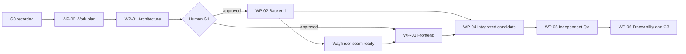

# Events Vertical Slice Work Plan

Run ID: `events-vslice-20261023-001`

Role: System Orchestrator

Status: `READY`

Repository commit or working-tree identifier: `39037c4577cd78abe2df0fd5a5cafe7ae0589750` plus the uncommitted planning artifacts for this run

Acceptance criteria: `EVT-001`–`EVT-004`, `REG-001`–`REG-006`, `ADM-001`–`ADM-005`, `QUA-001`–`QUA-003`

Input artifacts: `EVENT_SPEC.md`, `AGENTS.md`, `HUMAN_GATES_AND_GUARDRAILS.md`, `WORKFLOW_DESIGN.md`, `WORKFLOW_DIAGRAM.md`, `.agents/orchestrator.md`, `.agents/architect.md`, `artifacts/README.md`, `artifacts/DECISION_LOG.md`, `RUN_TRACE.json`

Output artifacts: `artifacts/WORK_PLAN.md`, `artifacts/checkpoints/events-vslice-20261023-001/orchestrator.md`

## Objective and authority

Deliver the smallest coherent public event discovery, attendee registration, and deliberately unauthenticated event-administration slice defined by `EVENT_SPEC.md`. G0 was recorded in commit `39037c4577cd78abe2df0fd5a5cafe7ae0589750` and approves governance baseline revision `869e7fbe7ddf35d5440aa99a61c8f43f183cc3cf` for planning and architecture only.

This plan and `artifacts/ARCH_SPEC.md` form the G1 package. No migration, application route, model, request, controller, test, React file, generated Wayfinder file, configuration, dependency, lockfile, or deployment file may be changed until the human records G1 approval. G1 approval authorizes only the bounded implementation and verification below; merge and deployment remain separately gated at G3 and G4.

## Baseline and inspected conventions

- PHP packages inspected with `composer show --direct`: Laravel `13.38.0`, Inertia Laravel `3.5.2`, Wayfinder `0.1.23`, Pest `5.3.3`, Pest Laravel plugin `5.0.1`, Pint `1.32.1`, Boost `2.10.3`.
- JavaScript manifest inspected in `package.json`: Inertia React `^3.0.0`, React `^19.2.0`, TypeScript `^5.7.2`, Tailwind CSS `^4.0.0`, Vite `^8.0.0`, Vite Plus `0.3.0`.
- Current application timezone is `UTC`; current default database connection is `sqlite`. The implementation must remain portable across supported Laravel database drivers and must not hard-code SQLite behavior.
- Existing conventions use controller classes, typed Form Requests, `Inertia::render`, `Inertia::flash`, React's Inertia `<Form>`, generated `@/actions` and `@/routes` imports, Radix-based UI components, Pest feature tests, and model factories.
- No `.ai/rules` directory or repository-local `skills/**/SKILL.md` was present at planning time. If either appears before implementation, the assigned specialist must read the applicable rules or activate the relevant skill before editing.

## Work packages

| WP     | Owner and artifact                                                                        | Scope                                                                                                                                                                                                                                            | Acceptance criteria                                                                  | Dependencies                                                                                | Required completion evidence                                                                                                                                           |
| ------ | ----------------------------------------------------------------------------------------- | ------------------------------------------------------------------------------------------------------------------------------------------------------------------------------------------------------------------------------------------------ | ------------------------------------------------------------------------------------ | ------------------------------------------------------------------------------------------- | ---------------------------------------------------------------------------------------------------------------------------------------------------------------------- |
| WP-00  | System Orchestrator — `artifacts/WORK_PLAN.md`, `RUN_TRACE.json`, Orchestrator checkpoint | Establish governed run, map all criteria, sequence work, enforce gates, serialize trace updates.                                                                                                                                                 | All criteria for traceability; no product criterion is claimed complete.             | G0 approval.                                                                                | Valid plan, trace, decision log, and checkpoint identifying G1 as the next action.                                                                                     |
| WP-01  | Solutions Architect — `artifacts/ARCH_SPEC.md`, Architect checkpoint                      | Fix the domain/schema, lifecycle, route/controller, Inertia prop/page, validation, duplicate-race, timezone, privacy, ownership, verification, and risk contracts.                                                                               | All criteria by design mapping.                                                      | WP-00; approved G0 baseline.                                                                | Complete architecture artifact and checkpoint accepted by Orchestrator; no application changes.                                                                        |
| WP-02A | Backend Engineer — `artifacts/BACKEND_HANDOFF.md`, Backend checkpoint                     | Add Event/Registration migrations, models, relationships, factories, deterministic queries, and database constraints.                                                                                                                            | `EVT-001`, `EVT-002`, `REG-003`–`REG-006`, `ADM-004`, `ADM-005`, `QUA-003`.          | Human G1 approval; WP-01.                                                                   | Focused Pest evidence, schema/index inspection, Pint, and handoff.                                                                                                     |
| WP-02B | Backend Engineer — same sole-owned handoff                                                | Add public/admin routes, route-model-bound controllers, Form Requests, timezone conversion, Inertia props/redirects/flash, graceful duplicate handling, generated Wayfinder contracts, and the approved database exception-binding privacy mask. | `EVT-001`–`EVT-004`, `REG-002`–`REG-006`, `ADM-001`–`ADM-005`, `QUA-001`, `QUA-003`. | G1; WP-02A schema contract.                                                                 | Route listing, focused Pest tests including 404 and unauthenticated access, generated contract, privacy configuration inspection, Pint, static analysis as applicable. |
| WP-03  | Frontend Engineer — `artifacts/FRONTEND_HANDOFF.md`, Frontend checkpoint                  | Build responsive public/admin Inertia pages and typed UI contracts; form labels/errors/processing/feedback; timezone labels; empty states; accessible navigation and table/list presentation.                                                    | `EVT-001`–`EVT-003`, `REG-001`–`REG-004`, `ADM-001`–`ADM-005`, `QUA-001`, `QUA-003`. | G1 and the stable WP-01 contract; Wayfinder integration waits for WP-02B's generated files. | `npm run check`, `npm run types:check`, `npm run build`, UI/accessibility review, and handoff.                                                                         |
| WP-04  | System Orchestrator                                                                       | Integrate specialist handoffs, reconcile repository state and contract adherence, assign independent QA.                                                                                                                                         | All criteria remain pending QA.                                                      | WP-02 and WP-03 ready; no unresolved contract drift.                                        | Integrated-candidate identifier and QA assignment.                                                                                                                     |
| WP-05  | QA / Reviewer — `artifacts/QA_REPORT.md`, QA checkpoint                                   | Independently verify the integrated candidate, acceptance behavior, regression/security/privacy/accessibility risks, schema invariant, and scope compliance. No silent remediation.                                                              | `EVT-001`–`EVT-004`, `REG-001`–`REG-006`, `ADM-001`–`ADM-005`, `QUA-001`–`QUA-003`.  | WP-04 integrated candidate and both specialist handoffs.                                    | Criterion-by-criterion results, exact commands, UI evidence, findings, and go/no-go recommendation.                                                                    |
| WP-06  | System Orchestrator — `artifacts/ACCEPTANCE_TRACEABILITY.md`                              | Resolve QA findings within the two-cycle limit, consolidate one evidence status per criterion, and present the exact revision at G3.                                                                                                             | All criteria.                                                                        | Accepted WP-05; any required remediation re-verified.                                       | Traceability artifact, updated decision log/trace, final checkpoint, G3 package.                                                                                       |
| WP-07  | Human-owned gates and deployment handoff                                                  | Human decides G3 merge and later G4 deployment. Orchestrator may prepare `artifacts/DEPLOYMENT_HANDOFF.md`; agents do not merge or deploy implicitly.                                                                                            | `QUA-002`, `QUA-003` plus operational gates.                                         | Successful QA and exact accepted revision.                                                  | Recorded gate decisions; separate deployment authorization if any.                                                                                                     |

## Acceptance-criterion assignment and evidence plan

| Criterion | Accountable implementation package(s) | Independent evidence required                                                                                                                                          |
| --------- | ------------------------------------- | ---------------------------------------------------------------------------------------------------------------------------------------------------------------------- |
| `EVT-001` | WP-02A/B, WP-03                       | Feature test for all events and `starts_at`, then `id`, ordering; Inertia prop assertions; responsive UI review.                                                       |
| `EVT-002` | WP-02B, WP-03                         | Feature test for successful empty response and empty-state prop/content.                                                                                               |
| `EVT-003` | WP-02B, WP-03                         | Feature test for event props and page; UI review of description, time, location, and registration form.                                                                |
| `EVT-004` | WP-02B                                | Feature test proving route-model binding returns normal 404.                                                                                                           |
| `REG-001` | WP-03                                 | Keyboard/accessibility review for associated labels, required attributes, actionable submit, focusable controls, and processing state.                                 |
| `REG-002` | WP-02B, WP-03                         | Feature tests for required/invalid input, no persistence, field errors, and retained normalized non-sensitive input; UI error review.                                  |
| `REG-003` | WP-02A/B, WP-03                       | Feature test for exactly one row, normalized values, redirect, and one-time in-app confirmation naming event and attendee.                                             |
| `REG-004` | WP-02A/B, WP-03                       | Feature test using case and surrounding whitespace; same-event row count stays one and `email` receives a clear error.                                                 |
| `REG-005` | WP-02A/B                              | Feature test proving the same normalized email may be stored once for each of two events.                                                                              |
| `REG-006` | WP-02A/B                              | Composite unique-index inspection and focused test that exercises the unique-constraint exception path; a real parallel test only if deterministic on the test driver. |
| `ADM-001` | WP-02B, WP-03                         | Feature tests requesting every admin page/action without authentication and proving no login redirect/middleware.                                                      |
| `ADM-002` | WP-02B, WP-03                         | Feature test for UTC persistence and success feedback; form UI review.                                                                                                 |
| `ADM-003` | WP-02B, WP-03                         | Create and update feature tests for required, format, and strictly-after boundaries; unchanged database assertions; UI errors.                                         |
| `ADM-004` | WP-02A/B, WP-03                       | Feature test for changed event, unchanged related registrations, redirect, feedback; edit UI review.                                                                   |
| `ADM-005` | WP-02A/B, WP-03                       | Feature tests for `created_at`, then `id`, ordering and no-registration state; UI/accessibility/privacy review.                                                        |
| `QUA-001` | WP-02B, WP-03                         | Code review of generated controller/route imports plus frontend type check.                                                                                            |
| `QUA-002` | WP-02, WP-03, WP-05                   | Focused Pest suite, `npm run check`, `npm run types:check`, and `npm run build`, recorded against the integrated candidate.                                            |
| `QUA-003` | WP-02, WP-03, WP-05                   | Diff/dependency/route review against exclusions and approved plan; no unapproved dependency or feature.                                                                |

## Dependencies and safe parallelism

- Before G1, only WP-00 and WP-01 may write their owned planning artifacts.
- After G1, Backend and Frontend may work concurrently against `artifacts/ARCH_SPEC.md` because their application write paths are separate. Backend is the sole writer of PHP, migrations, routes, backend tests, and generated Wayfinder files; Frontend is the sole writer of hand-authored `resources/js/**` feature UI and types.
- Backend must publish the route/controller names and generated Wayfinder seam early. Frontend may prepare page structure and exact prop types in parallel, but it must not create hand-written substitutes for generated routes/actions and must wait for the Backend-owned generated files before final integration.
- Both specialists must stop the affected work and route any prop, route, validation, schema, privacy, dependency, or security-boundary variance through the Orchestrator. Material variance triggers G2.
- QA starts only after the integrated candidate, Backend handoff, and Frontend handoff identify the same repository state. QA remains independent and does not silently edit implementation.

## Assignment briefs

### Solutions Architect assignment (WP-01)

- **Run/repository state:** `events-vslice-20261023-001`; base `39037c4577cd78abe2df0fd5a5cafe7ae0589750` with Orchestrator-owned planning artifacts.
- **Objective/scope:** produce the bounded contract in `artifacts/ARCH_SPEC.md`; all product acceptance IDs; no application implementation.
- **Inputs/outputs:** governing artifacts and inspected repository conventions in; `artifacts/ARCH_SPEC.md` plus `artifacts/checkpoints/events-vslice-20261023-001/architect.md` out.
- **Allowed tools/writes:** read-only repository, package, config, routes, schema, test, and version-scoped primary-documentation inspection; writes only to the two Architect-owned paths.
- **Required design:** Event/Registration fields, indexes and FK deletion behavior; normalized per-event email uniqueness and race handling; routes/controllers/requests; Inertia page/prop/error/flash contract; timezone conversion/display; personal-data boundaries; frontend/backend seam; verification and risk alternatives.
- **Verification:** artifact completeness against all 18 acceptance criteria; repository state reconciliation; hashes for inputs/outputs when checkpointed; no claim that implementation checks passed.
- **Budget/gate:** zero remediation cycles used; one safe retry for a transient tool failure; checkpoint and return to Orchestrator; stop at G1 or any G2 trigger.

### Post-G1 specialist constraints

- Backend paths will be limited to approved Laravel domain, migrations, routes, generated Wayfinder output, focused backend tests, `artifacts/BACKEND_HANDOFF.md`, the Backend checkpoint, and `config/database.php` solely to set `mask_bindings_in_exception_messages => true` on configured SQL connections so unexpected query exceptions cannot expose attendee email bindings. Exact paths must be enumerated in the implementation assignment after G1 and before edits.
- Frontend paths will be limited to approved event/admin pages, feature-specific components/types, `artifacts/FRONTEND_HANDOFF.md`, and the Frontend checkpoint. Existing starter functionality may remain but must not be required for event flows.
- QA is read-only except `artifacts/QA_REPORT.md`, its checkpoint, and tests only if the human/Orchestrator separately assigns test authoring.

## Verification sequence after G1

1. Backend runs the narrowest relevant Pest file or test filter after each behavior change, then the complete focused event/registration feature set.
2. Backend runs `vendor/bin/pint --dirty --format agent` after PHP changes, then applicable PHP static checks without changing dependencies.
3. Frontend runs `npm run check`, `npm run types:check`, and `npm run build` after integration with generated Wayfinder contracts.
4. QA repeats the focused Pest suite and all three required npm commands against one integrated revision, inspects the composite unique index and route list, and performs responsive keyboard/accessibility/privacy review.
5. The Orchestrator records results only after evidence exists. A check not executed successfully is `not run` or `failed`, never `passed`.

## Risks, assumptions, and controls

| Item                                                                                                            | Plan/control                                                                                                                                                                                                              | Gate impact                                                                         |
| --------------------------------------------------------------------------------------------------------------- | ------------------------------------------------------------------------------------------------------------------------------------------------------------------------------------------------------------------------- | ----------------------------------------------------------------------------------- |
| Unauthenticated admin exposes event mutation and registrant email data to any visitor who discovers the routes. | Preserve the explicit POC requirement; label the area accurately; send emails only to the admin registrant page; require explicit G4 exposure acceptance or infrastructure restriction before shared/internet deployment. | Residual risk must be accepted at G1; deployment remains G4-blocked.                |
| Validation-only duplicate checks race.                                                                          | Normalize before validation; application-scoped uniqueness rule for friendly normal duplicates; composite database unique index; catch only the unique-constraint failure and convert it to an `email` validation error.  | Fixed G1 contract; weakening it triggers G2.                                        |
| Browser-local date interpretation can shift event times.                                                        | Treat admin `datetime-local` input as `config('app.timezone')`, convert to UTC before persistence, send canonical timestamps, format with an explicit app timezone, and render a visible timezone label.                  | Fixed G1 contract.                                                                  |
| An unexpected database exception could include an attendee email binding in logs.                               | Explicit prop/log boundaries plus `mask_bindings_in_exception_messages => true` on configured SQL connections in `config/database.php`; Backend may change only this privacy setting in that file.                        | Bounded configuration path is part of G1; broader configuration changes trigger G2. |
| SQLite-focused tests may not prove every production-driver race behavior.                                       | Assert the portable unique index and controlled exception path; use an actually concurrent test only when deterministic for the configured test driver; record the limitation.                                            | Residual verification limitation, not permission to omit the invariant.             |
| A future event deletion path could orphan or destroy registrations.                                             | No deletion route; use a restrictive foreign key so deletion fails while registrations exist. Any lifecycle change requires G2 and a data plan.                                                                           | Proposed reversible safety decision for G1.                                         |
| Flash confirmation is one-time.                                                                                 | Redirect to the event GET after successful POST and carry only event title and attendee name in session flash; refresh cannot re-submit and may consume the confirmation. Never place email/name in the URL.              | Meets the specified PRG behavior; G1 approves this UX contract.                     |
| Dedicated seed data may create unnecessary demo records or PII-like fixtures.                                   | Create model factories needed for tests; omit a dedicated seeder unless the human separately requests demo data. All factory data remains synthetic.                                                                      | Non-blocking scope assumption.                                                      |

## G1 package and stop condition

G1 evidence consists of this work plan, `artifacts/ARCH_SPEC.md`, the updated `artifacts/DECISION_LOG.md`, `RUN_TRACE.json`, and both planning-phase checkpoints. The Orchestrator must verify that they identify the same run and base revision.

No unresolved requirement ambiguity currently blocks a G1 decision. The human must decide whether to approve the proposed contracts and explicitly accept the residual POC-only unauthenticated-admin exposure and the documented concurrency-test limitation. Until that decision is recorded, WP-02 through WP-07 are blocked.

## Verification performed for this artifact

- Read all governing documents and both planning-phase role charters named in the input header.
- Confirmed G0 commit `39037c4577cd78abe2df0fd5a5cafe7ae0589750` is based directly on approved baseline `869e7fbe7ddf35d5440aa99a61c8f43f183cc3cf`.
- Inspected current routes, configuration, manifests, controllers, Form Requests, models, migrations, Inertia pages/components, and Pest conventions without modifying application files.
- Consulted version-current Laravel 13 and Inertia v3 primary documentation because a callable Laravel Boost `search-docs` tool was not available in this execution environment.
- Product tests, lint, type checks, and builds were not run because this phase changes governance artifacts only and must not claim implementation evidence.

Remediation-cycle count: `0`

Next owner and requested action: Solutions Architect produces `artifacts/ARCH_SPEC.md` and its checkpoint. The System Orchestrator then validates the complete package and pauses for the human G1 decision.

## Implementation dispatch after G1

Human G1 approval was recorded on 2026-10-23. Implementation and verification are authorized from clean baseline commit `af3e21308985f713c9b2221b5aa09b78c97c5c89` on branch `codex/events-vslice-20261023-001`. The assignments below operationalize the already-approved WP-02 and WP-03 contracts; they do not change product or architecture scope.

### Backend Engineer assignment — WP-02A/WP-02B

- **Run/repository state:** `events-vslice-20261023-001`; baseline `af3e21308985f713c9b2221b5aa09b78c97c5c89`; branch `codex/events-vslice-20261023-001`.
- **Objective:** implement the approved Laravel persistence, HTTP/Inertia contract, duplicate invariant, privacy control, generated Wayfinder seam, and focused Pest coverage.
- **Acceptance criteria:** `EVT-001`–`EVT-004`, `REG-002`–`REG-006`, `ADM-001`–`ADM-005`, `QUA-001`–`QUA-003`; supply server props used by `REG-001` without owning UI.
- **Required inputs:** `EVENT_SPEC.md`, `AGENTS.md`, `HUMAN_GATES_AND_GUARDRAILS.md`, `artifacts/WORK_PLAN.md`, `artifacts/ARCH_SPEC.md`, `.agents/backend.md`, and applicable `.junie/skills/**` instructions.
- **Sole-owned outputs:** `artifacts/BACKEND_HANDOFF.md` and `artifacts/checkpoints/events-vslice-20261023-001/backend.md`.
- **Allowed application writes:** `app/Models/Event.php`, `app/Models/Registration.php`, `app/Actions/CreateRegistration.php`, `app/Http/Controllers/EventController.php`, `app/Http/Controllers/EventRegistrationController.php`, `app/Http/Controllers/Admin/EventController.php`, `app/Http/Controllers/Admin/EventRegistrationController.php`, `app/Http/Requests/Admin/SaveEventRequest.php`, `app/Http/Requests/StoreRegistrationRequest.php`, the Artisan-generated Event/Registration factory and create-table migration files under `database/**`, `routes/web.php`, `config/database.php` only for `mask_bindings_in_exception_messages`, focused event/registration PHP tests under `tests/**`, and generated `resources/js/actions/**`, `resources/js/routes/**`, `resources/js/wayfinder/**`.
- **Explicit exclusions:** hand-authored React pages/components/layouts/types, unrelated starter functionality, dependencies/locks, human-owned governance, another role's artifacts, merge, deployment, destructive database operations, and any route/prop/schema/privacy variance.
- **Dependencies and seam:** publish generated Wayfinder output immediately after the approved routes/controllers exist. Backend may continue tests while Frontend consumes the generated seam. Route names, page names, props, flash keys, date formats, and error keys must exactly match `artifacts/ARCH_SPEC.md`.
- **Required verification:** narrow Pest tests after each behavior increment; complete focused event/registration test set; `php artisan route:list --except-vendor`; schema/index inspection; `vendor/bin/pint --dirty --format agent`; `composer run types:check`; generated Wayfinder resolution. Record exact results and anything not run.
- **Retry/remediation:** one safe retry for a transient tool/environment failure; remediation cycle starts at `0`, maximum `2` per underlying criterion; checkpoint before pause/handoff.
- **Stop conditions:** any new dependency, contract/schema/privacy/security variance, destructive/shared-data action, need to touch an unlisted path, or conflict with Frontend routes/props routes through the Orchestrator and may require G2.

### Frontend Engineer assignment — WP-03

- **Run/repository state:** `events-vslice-20261023-001`; baseline `af3e21308985f713c9b2221b5aa09b78c97c5c89`; branch `codex/events-vslice-20261023-001`.
- **Objective:** implement the approved responsive, keyboard-usable public and deliberately unauthenticated admin experiences against the fixed Inertia/Wayfinder contract.
- **Acceptance criteria:** `EVT-001`–`EVT-003`, `REG-001`–`REG-004`, `ADM-001`–`ADM-005`, `QUA-001`–`QUA-003`.
- **Required inputs:** `EVENT_SPEC.md`, `AGENTS.md`, `HUMAN_GATES_AND_GUARDRAILS.md`, `artifacts/WORK_PLAN.md`, `artifacts/ARCH_SPEC.md`, `.agents/frontend.md`, applicable `.junie/skills/**` instructions, and Backend-generated Wayfinder modules when published.
- **Sole-owned outputs:** `artifacts/FRONTEND_HANDOFF.md` and `artifacts/checkpoints/events-vslice-20261023-001/frontend.md`.
- **Allowed application writes:** `resources/js/app.tsx`; new `resources/js/layouts/events-layout.tsx`; new event-specific files under `resources/js/pages/events/**`, `resources/js/pages/admin/events/**`, `resources/js/components/events/**`, and `resources/js/types/events.ts`; `resources/js/types/global.d.ts` only for the approved flash type if required. Existing reusable UI primitives may be imported but not rewritten without Orchestrator approval.
- **Explicit exclusions:** PHP/backend/config/migrations/routes/tests, generated Wayfinder files, dependencies/locks, broad style/theme changes, auth UI, deletion/search/payments/notifications/uploads, human-owned governance, another role's artifacts, merge, and deployment.
- **Dependencies and seam:** page shells/types may proceed from `artifacts/ARCH_SPEC.md`; final navigation and forms must wait for and import the Backend-owned generated `@/routes` / `@/actions` modules. Do not hard-code URLs or HTTP methods as a substitute.
- **Required verification:** `npm run check`, `npm run types:check`, `npm run build`; code review for generated imports and exact props/errors/flash; keyboard/focus/label/error/processing/empty-state/timezone/admin-warning review at responsive widths. Record exact results and anything not run.
- **Retry/remediation:** one safe retry for a transient tool/environment failure; remediation cycle starts at `0`, maximum `2` per underlying criterion; checkpoint before pause/handoff.
- **Stop conditions:** any prop/route/validation/timezone/privacy change, need to edit generated/backend/unlisted paths, new dependency, or material UX scope variance routes through the Orchestrator and may require G2.

### Orchestrator coordination rule

Backend and Frontend may run concurrently because their hand-authored write paths do not overlap. The only shared integration seam is Backend-owned generated Wayfinder output, which Frontend reads after publication. Neither specialist may commit, merge, deploy, or edit Orchestrator/other-specialist artifacts. Independent QA begins only after both handoffs are READY against the same working-tree state.

### QA / Reviewer assignment — WP-05

- **Run/repository state:** `events-vslice-20261023-001`; baseline `af3e21308985f713c9b2221b5aa09b78c97c5c89`; integrated implementation candidate identified by Backend handoff SHA-256 `50f8898d4b95b93f6b139c349502e6fa83549bf2b91446d9271872ecad038727` and final `READY` Frontend handoff SHA-256 `28fb20cd2402951a1b20bb16db2fae94fd836f71121ea44d39387b5fb7d75212`.
- **Objective:** independently verify the integrated candidate against every approved acceptance criterion and provide an evidence-backed go/no-go recommendation for G3. Do not repair implementation silently.
- **Acceptance criteria:** `EVT-001`–`EVT-004`, `REG-001`–`REG-006`, `ADM-001`–`ADM-005`, `QUA-001`–`QUA-003`.
- **Required inputs:** governing artifacts, approved work plan and architecture, Backend and Frontend handoffs/checkpoints, implementation diff, generated Wayfinder seam, and `.agents/test.md` plus applicable testing guidance.
- **Sole-owned outputs:** `artifacts/QA_REPORT.md` and `artifacts/checkpoints/events-vslice-20261023-001/qa.md`.
- **Allowed tools:** read-only repository/Git inspection; focused and full Pest; Pint/static analysis; route/schema/generated-contract inspection; `npm run check`, `npm run types:check`, `npm run build`; responsive keyboard/accessibility/privacy review. Temporary isolated test data is allowed only through existing tests/factories or a disposable database; do not mutate shared data.
- **Explicit exclusions:** no application, dependency, lockfile, product-contract, human-governance, specialist-artifact, merge, deployment, or remediation writes. Tests remain read-only unless the Orchestrator separately authorizes a remediation cycle.
- **Required verification:** reproduce specialist evidence independently; verify all 18 criteria, failure modes, unauthenticated admin access, public-email privacy, database uniqueness/FK/indexes, generated route use, exact required checks, scope/dependency integrity, and accepted residual risks. Record exact commands, exit status, findings, and evidence not run.
- **Retry/remediation:** one safe retry for transient environment failure; QA remediation-cycle count starts at `0`; route defects through the Orchestrator with severity, evidence, affected criterion, and accountable layer. Stop after two cycles for the same underlying criterion.
- **Checkpoint/gates:** checkpoint before pause or handoff. Any requirement ambiguity, dependency/security/privacy/schema variance, destructive/shared-data action, or deployment request stops and escalates. QA may recommend but cannot authorize G3 acceptance, merge, or G4 deployment.
